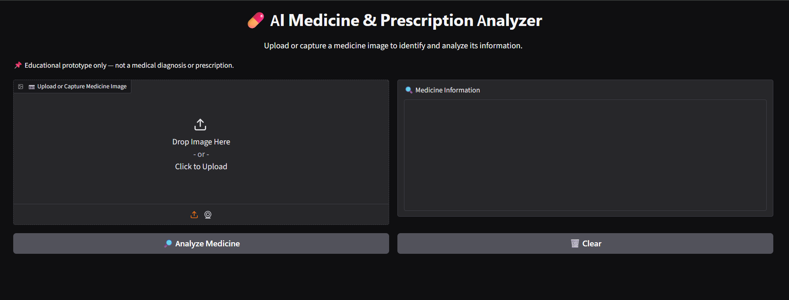
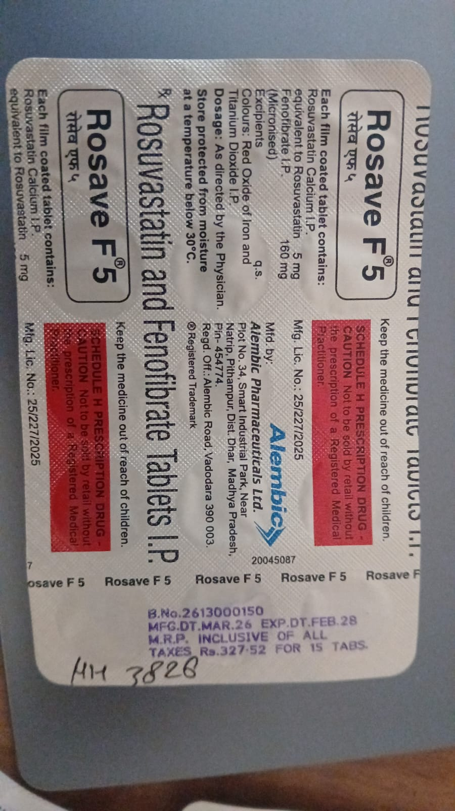
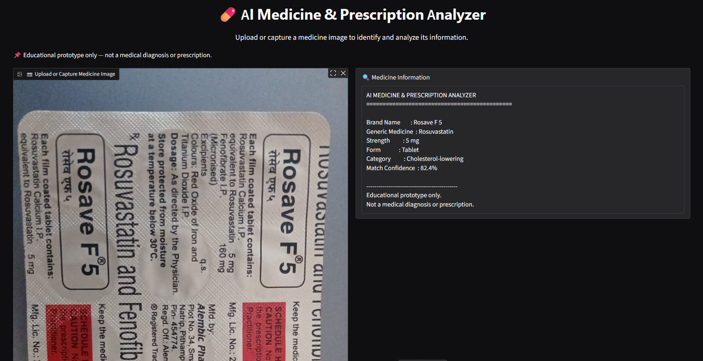

# 💊 AI Medicine & Prescription Analyzer

An AI-powered educational prototype that uses OCR and database matching to identify medicines from uploaded images and display relevant information.

## ✨ Features
- Upload medicine images for analysis
- Extract text using Optical Character Recognition (OCR)
- Match extracted text with a medicine database
- Display medicine information, including generic names, dosage, and common uses
- Interactive interface built with Gradio

## 🛠️ Technologies Used
- Python
- Google Colab
- Gradio
- OCR
- Database Matching

## 🚀 How It Works
1. Upload an image of a medicine label.
2. OCR extracts text from the image.
3. The extracted text is matched against the medicine database.
4. The application displays the closest matching medicine and its available information.

## ⚠️ Disclaimer
This project is an educational prototype only. It is not intended for medical diagnosis, treatment decisions, or prescribing medication. Always consult a qualified healthcare professional.

## 👩‍💻 Author
Aarya Waghmare

## 📸 Project Screenshots

### Application Interface

### Sample Medicine Image

### Medicine Analysis Result

